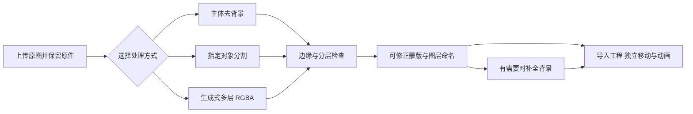
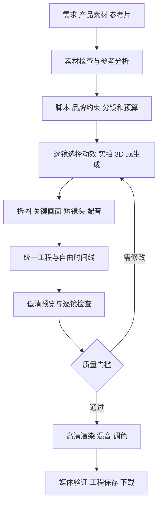

# NEXUS：从模板广告工作台到可编辑的 AI 宣传片系统

调研日期：2026-11-08（北京时间）。这是技术选型与实施方案，不是新功能完成或腾讯云上线公告。基线为现有 `0.5.4`，提交 `5e739a6`。本次没有改动应用行为、安装模型、升级依赖或连接生产服务器。

## 1. 决策与核验范围

建议采用 **video-shotcraft 的镜头方法、部分工作台代码和镜头组件 + 现有 Remotion 渲染服务 + Qwen-Image-Layered 图片分层 + 独立的图像／视频模型服务**。保留已经验证的源码、测试、素材与声音链路，重建统一工程、自由时间线和自动制作流程。

不要用“装齐 Skills”作为产品交付目标。交付目标是：用户上传自己的产品，得到可逐镜修改、有独立声音轨、能够保存重开并真实导出的工程与成片。

本次实际进行了：

- GitHub 网页仓库检索，核对 28 个仓库的固定提交，读取 86 份固定提交文档、许可证及若干关键源码。GitHub 连接器未暴露工具，搜索 API 被代理拒绝；网页搜索、公开 Issue、官方 raw 文件和 Git 读取可用。
- 重新读取原始 [Issue #1](https://github.com/yma71687-del/123/issues/1)，对照本地工程结构和当前能力记录。
- 在当前项目 Remotion `4.0.538`、真实 Chromium 下运行上游 `FlyingWords` 和 `ExplodedView`：各渲染第 15、75、135 帧，共六张 1920×1080 图像，全部成功，检查了画面与帧间变化。
- 没有运行完整 ShotCraft Workbench，没有测完 150 个镜头，没有执行 Qwen／SAM／Wan／LTX 推理，也没有验证任何供应商的实际费用。上游文档中的效果和性能不能当作本项目实测结果。

来源、固定提交及文件 SHA256 见 [调研来源清单](research/VIDEO_STACK_SOURCES_2026-11-08.json)；六帧实测记录见 [兼容性结果](research/SHOTCRAFT_SMOKE_2026-11-08.json)。用户新抖音参考中的确切 Skill 仍未识别，不能声称已经找到该视频同款仓库。

## 2. 从第一性原理重新定义问题

一条可交付的宣传片由六类确定信息组成：**讲什么、用什么素材、每个时刻显示什么、如何运动、如何发声、如何编码交付**。AI 可以提出这些信息并生成素材，但编辑器和渲染器必须能准确执行和重新打开它们。

| 根本约束 | 工程推论 |
| --- | --- |
| 单张图片只有最终可见像素，没有原始图层、背面和被遮挡内容 | 分割、生成式分层、背景补全、真实 3D 必须分别表示；不能承诺任意图片无损恢复 |
| 生成模型会改变文字、形状、Logo 和产品细节 | 品牌字、参数、价格及核心产品特写优先使用原图、矢量文字、实拍或准确模型；生成镜头需要一致性审片 |
| 用户要修改结果，而不只是拿到一个 MP4 | 所有镜头、图层、字幕、音乐和音效都要在统一工程中保留来源与可编辑参数 |
| 浏览器预览和服务端输出可能产生差异 | 使用同一份工程、组件版本、字体与素材快照；以同帧图像和实际媒体检查证明一致性 |
| 重试会消耗算力、接口额度和时间 | 按镜头缓存、单镜重做、任务恢复、费用上限是核心功能，不是后期补丁 |
| 电影感来自构图、光线、材质、镜头、节奏、色彩和声音的配合 | 科技网格、发光和粒子只是风格组件；整片导演设计与视觉审片必须单独验收 |

由此分成三种制作路径，允许在同一成片中混用：

1. **可控动效**：产品图／页面／真实数据 → 分层与排版 → 2.5D 运镜、文字和图表动画 → 声音 → 渲染。最容易保证文字准确、品牌一致和可编辑，是第一条主线。
2. **电影镜头**：产品参考图／实拍 → 关键帧和镜头描述 → 图生视频或实拍处理 → 逐镜挑选 → 剪辑调色混音。镜头真实感更强，但生成结果存在不确定性，不能保证一次成功。
3. **准确 3D**：CAD／GLB／人工建模 → 材质灯光相机 → 渲染通道 → 合成。适合真实旋转、拆机和结构展示。没有准确模型时，不能把单张图生成的外形当作真实产品内部结构。

## 3. GitHub 选型：采用什么，以及为什么

### 主线组件

| 仓库 | 解决的问题 | 推荐使用方法与边界 |
| --- | --- | --- |
| [Vincentwei1021/video-shotcraft](https://github.com/Vincentwei1021/video-shotcraft) | 产品宣传片分镜、运镜、节奏、声音、Remotion 镜头库和后期工作台 | 首选镜头来源和时间线参考。官方当前标注 124 张配方卡／150 个动态预览；本次只实渲两个组件。Apache-2.0 代码与文档，素材另核许可 |
| [memex-lab/product-launch-video-skill](https://github.com/memex-lab/product-launch-video-skill) | 产品定位、美术方向、结构化分镜和生成素材计划 | 提炼为广告导演阶段的规则和 storyboard 输入；MIT。它是制作指导，不是现成云端系统或模型服务 |
| [remotion-dev/remotion](https://github.com/remotion-dev/remotion) ＋ [remotion-dev/skills](https://github.com/remotion-dev/skills) | 代码驱动的动画、React 预览和逐帧输出 | 延续现有主渲染链。Skills 已有安装，本次不重复安装。Remotion 自定义许可，个人及最多三名员工的营利组织等可符合免费条件，其他情形按实际条款核对 |
| [QwenLM/Qwen-Image-Layered](https://github.com/QwenLM/Qwen-Image-Layered) | 从图片生成多层 RGBA | 图片分层主候选，服务端返回真实透明图层。官方提供可变层数及 PSD／PPTX／ZIP 导出示例，建议 640 分辨率档；不代表保留原始像素或恢复真实源图层。Apache-2.0 |
| [danielgatis/rembg](https://github.com/danielgatis/rembg) | 商品／人物主体去背景 | 简单背景的轻量起点与降级路径，可 CPU 运行。库为 MIT；具体所选模型权重另核。去背景不等于多对象分层 |
| [Comfy-Org/ComfyUI](https://github.com/Comfy-Org/ComfyUI) | 可固定版本的图像／视频处理工作流和推理接口 | 作为独立 GPU 服务，通过审核后的 API 工作流调用。固定模型、节点及工作流哈希，不把节点编辑器暴露为用户必经步骤。GPL-3.0，节点与权重各自有许可 |
| [Wan-Video/Wan2.2](https://github.com/Wan-Video/Wan2.2) | 文生／图生视频短镜头 | 图生视频第一候选之一。官方 TI2V-5B 的特定卸载配置要求至少 24GB 显存，A14B 示例至少 80GB；不是现有普通云主机可直接承担的能力。Apache-2.0 |
| [Lightricks/LTX-2](https://github.com/Lightricks/LTX-2) | 音视频联合生成、图生视频、镜头处理 | 与 Wan 用相同素材比较后择一主用，不同时堆入生产。仓库当前已包含 LTX-2.5；代码 Apache-2.0，模型另有 Community License，不能把代码许可等同权重许可 |
| [SYSTRAN/faster-whisper](https://github.com/SYSTRAN/faster-whisper) ＋ [m-bain/whisperX](https://github.com/m-bain/whisperX) | 口播转写、时间戳和可选强制对齐 | 先做中文转写及可修正字幕，再按需要加入字级对齐。前者 MIT、后者 BSD-2-Clause；对齐和说话人模型另核。CPU 路径可用不代表足够快 |
| [FFmpeg/FFmpeg](https://github.com/FFmpeg/FFmpeg) | 规范化、代理视频、混音、调色、编码与媒体验收 | 继续使用；许可证取决于构建配置和编解码库。真正检查成片画面、音轨、时长与可解码性 |

### 需要跟踪、不能直接整体套入的项目

| 仓库 | 调研判断 |
| --- | --- |
| [0xsline/OpenChatCut](https://github.com/0xsline/OpenChatCut) | 很接近“对话驱动真实时间线”：Remotion、编辑命令、MCP、多轨和导出；但定位 local-first，含本地服务／Electron，不是已经完成多用户隔离的腾讯云 SaaS。AGPL-3.0-or-later，整合需要接受对应许可义务。本次未启动，作为整体替换的备选方案 |
| [OpenMontageInc/OpenMontage](https://github.com/OpenMontageInc/OpenMontage) | 值得参考任务分阶段、素材产物、费用记录和质量门槛。其架构文档明确由外部 coding assistant 充当 LLM，而不是自带完整服务端 LLM 调度；不能直接视为无人值守云端系统。AGPLv3。提供商与宣传片样例是上游说明，本次未复测 |
| [OpenCut-app/OpenCut](https://github.com/OpenCut-app/OpenCut) ／ [opencut-app/opencut-classic](https://github.com/opencut-app/opencut-classic) | 主仓库明确正在从头重写；Classic 文档也说明预览和导出在重构。MIT，但现阶段不作为交付主底座，避免把我们已有的真实渲染链换成另一条待验证链 |
| [designcombo/react-video-editor](https://github.com/designcombo/react-video-editor) | 当前 README 已指向 OpenVideo 体系，依赖 `@openvideo/*`，有 WebCodecs 多轨与浏览器导出。当前许可证为自定义免费／公司双层许可，并非可以按旧印象当 MIT 免费组件。会引入 Pixi/WebCodecs 和 Remotion 两套语义，先不采用 |
| [AIDC-AI/Pixelle-Video](https://github.com/AIDC-AI/Pixelle-Video) | Apache-2.0，适合借鉴 ComfyUI、图像／视频／TTS 原子能力编排；不直接承担自由 3D 和精密关键帧编辑 |
| [harry0703/MoneyPrinterTurbo](https://github.com/harry0703/MoneyPrinterTurbo) | MIT，可参考脚本、配音、素材拼接和批量任务；更适合信息短视频，不能直接满足电影产品广告的镜头与品牌一致性要求 |
| [motion-canvas/motion-canvas](https://github.com/motion-canvas/motion-canvas) | MIT，代码驱动矢量讲解动画很强。与当前 Remotion 重叠，初期不增加第二套动画运行时；有特定效果时可输出透明片段再合成 |
| [facebookresearch/sam3](https://github.com/facebookresearch/sam3) | 可提示的对象分割／视频追踪候选；需要 checkpoint 访问和 CUDA，采用 SAM 自定义许可。本次不当作已开箱的图片拆层服务；必要时评估 SAM2 等替代，不与生成式分层混淆 |
| [blender/blender](https://github.com/blender/blender) ＋ [pmndrs/react-three-fiber](https://github.com/pmndrs/react-three-fiber) | 前者用于真实灯光／材质／离线 3D，后者用于交互预览。Blender 为 GPL，Fiber 为 MIT。普通照片与真实 3D 结构之间仍有建模工作 |
| [Breakthrough/PySceneDetect](https://github.com/Breakthrough/PySceneDetect) | BSD-3-Clause，可补充参考片镜头边界检测；不负责理解艺术风格或自动复刻 |
| [iart-ai/motion-skills](https://github.com/iart-ai/motion-skills) | MIT 的分类技能入口，可按需求补充文字、图表、品牌动效规则；逐子仓库核验，不批量安装未知执行脚本 |

特别注意：[video-talkcraft](https://github.com/Vincentwei1021/video-talkcraft) 功能与中文口播需求接近，但本次固定提交的许可为 **PolyForm Noncommercial**。不默认用于商业广告系统，也不将它的 108 张卡当作可免费集成的库存。可单独取得适用授权或采用许可合适的独立实现。

代码许可、模型权重、字体、音乐、产品素材和第三方 API 授权是不同事项。ShotCraft 的音频说明还把一首历史 BGM 标为无法逐曲反查、商用前复核；因此不把整包音频自动并入广告素材库。

## 4. ShotCraft 如何实际接入，而不是再做一个套壳

已检查上游 `workbench/src/types.ts`、`store.ts`、`preview/Composition.tsx`、`vite.config.ts` 及接入契约，得到以下事实：

- 已有 `Project → Track → Clip`、按帧计时、剪切、移动、裁入、匀速重映射、层级和属性面板，是实用的编辑起点。
- **部分 demo 的 schema 为空**：只能调整时间、图层和整体变换；要改文字、颜色、产品图，必须把源码常量提成 props 并提供 schema。
- 文档中的“爆炸拆解”示例是按代码预先构造的 UI 图层。它本身没有把任意上传图片智能分层；我们的拆层服务必须另做。
- 已有变速主要是匀速，专业的属性关键帧、曲线变速、音量包络和相机动画仍需扩展。
- 默认本地 localStorage 保存、符号链接工程源码、Vite 开发服务器启动 Remotion CLI，不适合直接公网交付。
- 上游工作台锁定 Remotion `4.0.484`、React `19.2.7`、Three `0.185.1`；当前工程是 Remotion `4.0.538`、React `19.2.0`、Three `0.160.0`。不能直接混装依赖，两个简单镜头通过不等于 3D／模糊组件全部兼容。

接入设计：以 ShotCraft 的时间线／卡片为参考或受控移植，保留 NEXUS 的品牌与服务接口；将本地文件链接改为素材 ID，将导出改接持久化任务，将 localStorage 改为云端工程版本。固定同号的 `@remotion/*`；Three 和其他新增依赖先在独立实验包验证，不全局升级。

第一批仅挑 **12 个真正参数化并逐个验收的镜头**：两种品牌开场、两种产品主视觉、三种运镜／分层、两种卖点／数据、两种转场、一种片尾。其余镜头列入待适配库，不显示为可用。每个镜头都交付真实封面、动态预览、参数 schema、输入约束、声音提示、源码版本及输出样片。

首批界面采用清晰的剪辑工作区：左侧“素材／图层／镜头”，中央大预览，右侧选中对象参数，下方可实际操作的画面、字幕、配音、音乐、音效轨；另设制作进度与费用面板。“AI 修改”落为可撤销的编辑命令，不能改变时间线外的另一份隐形成片。

## 5. 统一工程是这次重构的中心

新建独立命名的 `ProjectIR v1`，不把现有广告 v2 或 3D v4 的版本号重新解释。建议字段：

```text
ProjectIR
  id / ownerId / schemaVersion / revision / createdAt
  frameRate { numerator, denominator } / width / height / durationFrames
  brand { logoAssetId, palette, fontAssetIds, requiredCopy }
  assets[] { id, sha256, kind, source, license, metadata, derivedFrom }
  shots[] { id, fromFrame, durationFrames, recipeId, recipeVersion, params }
  tracks[] { id, kind, clips[], mute, gain }
  clips[] { assetId|shotId, startFrame, sourceInFrame, durationFrames, transform }
  keyframes[] { targetId, property, frame, value, easing }
  generationRuns[] { provider, modelRevision, workflowHash, seed, inputs, outputs, cost }
```

这是拟议合同，不是本次已实现的 schema。工程只存 JSON 与素材引用，不接受上传可执行 React／Python 源码。镜头从预先审核、构建好的注册表选择。

工程时间统一使用整数主时间轴帧，保留有理数帧率；可变帧率素材先生成规范代理并记录源时间映射，字幕毫秒在边界转换。明确裁入、裁出、定格、变速、跨轨层级和混音语义。

同一工程同时驱动浏览器 Player、服务端 Remotion、字幕、音频和最终混合；若增加 Blender，只把其输出作为有版本的素材进入工程。高成本镜头以 `素材哈希 + 镜头版本 + 参数 + 帧率 + 字体 + 渲染配置` 缓存；转场有前后依赖，修改时重渲受影响镜头和必要邻段。

服务端将单个共享 `project.json` 升级为多项目与版本表，先用 PostgreSQL 记录项目、素材、任务和尝试次数。`revision`／`If-Match` 防止旧浏览器覆盖新修改，自动保存与手动版本快照分开。第一版使用数据库任务租约即可，不同时增加 Redis、Kafka 和 Kubernetes。

现有工程只做**显式导入到新项目**：旧广告可先作为一个可编辑的 legacy 镜头保留原参数；不假装已经拆成任意图层。原 3D 工程保留对象数据和备份，逐项映射已支持字段，不丢弃未支持字段，不原地覆写旧文件。

## 6. 图片拆层服务的真实产品定义



- **主体去背景**：rembg 的合适模型输出前景 RGBA；保留原尺寸、alpha 和原图，允许手工修边。
- **对象分割**：用户点选／框选“瓶身、瓶盖、背景”等，模型输出多个 mask。细发丝、透明玻璃、反光金属和重叠边缘需要特殊检查。
- **生成式分层**：Qwen-Image-Layered 输出可编辑的 RGBA 图层及组合预览。输出是模型估计的层表示，可能重新生成文字、纹理、遮挡部分；不能视为源 PSD 恢复。
- **补全**：移走物体后出现的缺口由图像编辑／补全服务单独处理，记录为生成内容。原图中不可见的东西没有可验证的唯一真值。
- **可编辑文字**：OCR 只能读出文字及近似位置，不能保证恢复字体、字距、描边和混合模式。要成为原生文字层，需重新排版并校对。
- **2.5D 与 3D**：图层加深度可以制造视差，不能任意大角度观察背面；真实结构动画使用准确的三维模型。

每次输出至少包含：有序层文件、mask／alpha、统一画布尺寸、bbox、建议名称、原图与合成对比、模型版本／种子、生成标记和编辑记录。不得裁切后丢掉图层原始位置；透明边缘、色彩空间与预乘 alpha 必须在深浅底上检查。

初次只在有授权的 20 张基准图上测普通商品、复杂背景、透明材质、重叠对象和带字海报，每类 4 张。报告边界问题、文字／产品细节变化、时间和峰值显存；效果不好时返回可修正结果或明确失败，不能用原图加几个框冒充拆层。

## 7. AI 工作流：有产物、有状态、能修改



脚本、分镜、素材、镜头和验收分别是有 schema 的阶段产物，不需要先部署一群没有边界的 Agent。可先用一个编排服务按 DAG 运行，再按收益增加并行阶段。

工具合同统一为 `analyzeReference`、`decomposeImage`、`generateShot`、`transcribe`、`applyEdits`、`render` 等；每个工具声明输入、输出、所需服务、预计资源和费用。MCP 是可选控制接口，连接同一套命令与任务；Skills 是开发／创作知识，GPU 与 API 是执行能力，它们不能互相替代。

任务状态至少有 `queued / running / succeeded / failed / cancel_requested / cancelled / needs_review`。记录每一步的进度、错误、供应商 task ID、输入哈希、结果和费用；页面刷新或进程重启后能够查询与恢复。外部提交使用内部幂等键，但供应商不支持幂等时，超时必须先查询状态，不能直接重发并重复计费。取消本地任务不等于供应商停止收费，界面如实反馈。

优先使用合适的官方模型 API，预算和使用量稳定后再决定自托管；只给通过真实任务验收的模型显示“可用”。服务未配置时显示具体缺项；生成失败不可悄悄换成静态缩放再称为电影镜头。

## 8. 电影质感如何落实

第一条验收片采用自有或获得授权的产品素材，目标为 30 秒、16:9、1920×1080、30fps。计划六镜，可在统一工程逐镜替换：

| 时间 | 画面目的 | 首选技术 | 质量检查 |
| --- | --- | --- | --- |
| 0–3s | 产品主视觉和品牌开场 | 原产品图／3D、受控光线、标题 | 产品与 Logo 清晰、构图干净 |
| 3–8s | 材质与使用价值 | 实拍／准确 3D；可选经审片的生成镜头 | 材质可信、形状和标签稳定 |
| 8–13s | 图层／功能拆解 | 真实 RGBA 分层、2.5D 运镜 | 独立图层可移动、alpha 无明显毛边；不冒充机械拆机 |
| 13–18s | 场景氛围与情绪 | 图生视频／授权实拍 | 时序稳定、人物／产品身份一致 |
| 18–25s | 核心卖点与证据 | 动态字卡、原生图表和数据 | 中文不截断，数字和用户输入一致 |
| 25–30s | 品牌收束与行动信息 | 主视觉、准确文案、音乐收束 | 片尾可读、声音不突断 |

每镜先确定光线方向、景别、运动动机、调色和声音事件。排版、中文字体和产品信息在模型输出后用受控图层完成；AI 不负责最终价格、参数和 Logo 的拼写。

声音分配音、音乐、环境、转场和强调音效五类独立轨，支持增益、静音、淡入淡出和人声 ducking。首版可只提供经核验的声音库和 TTS，再接入生成音乐／音效。平台完整响度目标可先定为可配置的约 -16 至 -14 LUFS、true peak 不高于 -1 dBTP，由最终平台规格决定；不是对现有样片的测量结论。

第一阶段交付 SDR Rec.709；色彩变换需正确处理图片与视频色域。HDR、复杂流体、毛发、物理粒子和 4K 批量产出不列入首批可用功能。

## 9. 腾讯云部署与算力

现有腾讯云继续承担经过容量检查的入口／轻量服务；生成与重渲任务应放独立 worker，避免抢占其他业务。真实远程硬件和资源余量尚未核验，下表只是容量规划起点。

| 服务 | 初始规划 | 如何控制成本 |
| --- | --- | --- |
| UI、鉴权、项目 API、任务协调 | 2–4 vCPU／4–8GB RAM，实际按并发测 | 静态资源缓存；不在请求线程渲染 |
| Remotion／FFmpeg 渲染 worker | 独立 4–8 vCPU／8–16GB RAM 起测，初始并发 1 | 低清代理、按镜头缓存、预览与高清任务分级 |
| 简单抠图／小模型转写 | CPU 独立队列，是否迁 GPU 以实测决定 | 模型驻留和批处理受内存限制，避免混合并发挤占主服务 |
| Qwen 分层与图像编辑 | 独立 GPU 或可用托管服务 | 先测 640 档、少层数、小批次；本次没有确认最低显存，不宣称某张 24GB 卡一定可跑 |
| 视频生成 | 官方 API 或按任务启动 GPU | Wan 5B 的官方特定配置至少 24GB，较大模型和高分辨率需求更高；量化与卸载需测试质量和延迟 |
| 文件和备份 | 腾讯 COS 等对象存储，项目元数据进入数据库 | 原件、代理、生成资产、最终片分生命周期；临时签名访问，禁止公开桶承载私有工程 |

“开源”只表示代码／权重授权方式，不表示免算力费。单条片成本按以下公式记录：

`文本／视觉模型 + 图片处理次数×单价 + Σ(生成秒数×候选数×视频单价) + GPU运行时长×时价 + CPU渲染 + 存储流量`

例如，假设某服务报价为 ¥2／生成秒，生成 20 秒素材、每镜平均两个候选，仅视频就约 ¥80；**这是计算示例，不是已核验供应商报价或对最终成片费用的承诺**。30 秒受控动效和 30 秒全生成电影镜头的成本不应混报。

第一版提供单工程最高预算、每镜最多候选数、失败重试上限、低清试片和费用明细。预算接近上限时保留已有产物，不自动扩大额度。

上线使用新目录、独立容器项目、独立卷与未占用的 loopback 端口。先验证服务和成片，再将固定域名／已有入口的明确子域转发到新实例；不停止原 Nginx，不抢 80／443，不修改其他业务路由，不做全局清理。使用现有入口需要先核对配置、备份并形成具体变更。

旧 `v053`、`v054` 与原 live 目录均不原地覆盖。迁移只从只读副本导入；回滚入口和应用时保持新版本数据可恢复。Quick Tunnel 只能用于临时测试，不作为长期交付地址。当前仍没有可核验的新公网网址，也没有能接管用户控制台的会话。

## 10. 吸纳旧方案，并明确替换范围

| 现有成果 | 新方案处理 |
| --- | --- |
| React＋TypeScript、素材导入、错误反馈 | 保留，逐模块接入新编辑核心 |
| 四个 Remotion 模板、已验证 MP4／透明输出 | 保留为 legacy 镜头与回归基线；不把四个模板扩写成全部场景 |
| 音乐、12 条音效、字幕和实际带声渲染 | 迁移到独立轨道；增加混音、波形、包络和一致时间映射 |
| 参考片抽帧、OCR、音轨提取 | 保留作为分析前处理，增加镜头检测、转写和语义分析；抽帧不等于风格理解 |
| 原 3D 对象、材质、变换和撤销重做 | 保留工程与交互经验；需要重新接入多轨和服务端渲染，不能把原来无声录屏称为成片 |
| 固定三段分镜导航 | 在专业模式替换为真实多轨剪辑；简单模式可以继续提供步骤引导 |
| 单个共享工程文件 | 替换为按所有者／项目隔离的数据库与版本快照 |
| 本机单 HTML 试用包 | 保留为历史试用；新的云端系统不依赖此包承担生成和存储 |
| 固定包 SHA、独立部署、容器保护、真实媒体验收 | 保留并扩展；不重复让用户运行未验证的生产脚本 |

## 11. 按可验证里程碑实施

不先承诺一个缺乏基准的“一次性全部完成日期”。下列工作量是有开发和测试条件时的粗估人日，按顺序有依赖，不代表可直接折算为本助手或日历交付承诺；模型授权、GPU 获取、视觉返工和生产访问另计。

| 阶段 | 交付与硬性验收 | 粗估工作量 |
| --- | --- | --- |
| A：接入验证 | 同源工程合同、3 个完整可编辑镜头、中文字体、真实导出、源码适配清单；Workbench 与现有渲染预览同帧对照 | 3–5 人日 |
| B：可用编辑器 | 多项目、保存重开、12 个参数化镜头、素材拖放、剪切裁剪吸附、图层顺序、独立声音和基础属性关键帧；浏览器 E2E | 10–15 人日 |
| C：真实图片分层 | 抠图和 Qwen 分层至少各一条实际推理路径、图层检查／修正／导入、20 张基准图报告、延迟／峰值显存和费用 | 5–8 人日，取决于模型与资源 |
| D：AI 广告工作流 | 需求到结构化分镜、转写／配音、一个图生视频 provider、单镜重做、任务恢复和预算约束；30 秒完整工程与成片 | 8–12 人日，另计视觉迭代 |
| E：上线验收 | 独立环境、备份恢复、固定域名 HTTPS、访问隔离、任务负载、旧工程迁移、回滚与其他业务检查 | 3–5 人日，依赖安全连接与域名条件 |

按表粗加约 29–45 人日，是这组受限目标的规划范围，不包括任意真实 3D、复杂流体、全部上游镜头参数化、无限多人协作或全部参考片复刻。任何阶段未通过，就报告具体阻塞和已可用部分，不能用界面截图替代验收。

下一批实际代码应从 A 开始：新增 ProjectIR 合同与旧广告只读导入器，适配三个镜头；其中一个必须支持用户原图替换、一个必须支持独立时间线编辑，最终在现有服务真实导出。随后再将成熟模块并入主工作台。

## 12. 测试必须证明什么

- **编辑**：真实文件上传；多轨移动／剪切／裁剪／吸附；文字、素材和关键帧改变真实画面；单次拖动可撤销；保存重载与多窗口版本冲突；没有不可用的伪按钮。
- **渲染**：同一快照下浏览器与服务端关键帧差异在定义容差内；中文字体、透明边缘、比例、安全区、视频裁入、帧数和声音时点正确。
- **AI**：真实模型请求和产物；语义图层可分离；产品／文字变化可被发现并修正；任务失败、缺配置、超时、取消和预算上限可见。mock 只测合同，不能证明推理已可用。
- **成片**：ffprobe 检查可解码、分辨率、帧率、时长和音轨；FFmpeg 检查黑帧、异常定格、音量与削波；抽取镜头切点及高风险运动片段人工审片。机器检查通过不等于电影质感通过。
- **生产**：新实例通过公网保存、上传、生成、下载；备份可恢复，回滚可执行，原有业务仍可用。容器 Running 和本地测试不能代替这些结果。

本次只完成选型、架构文档和两个上游镜头的六帧兼容性试验。没有宣称图片分层、AI 自动广告、完整时间线或腾讯云上线已经完成。
